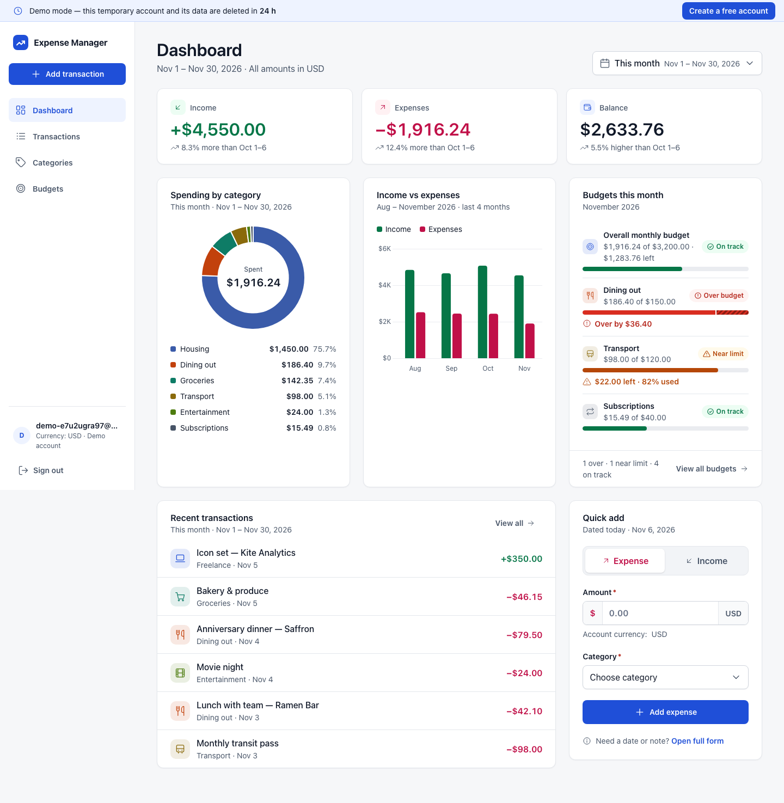
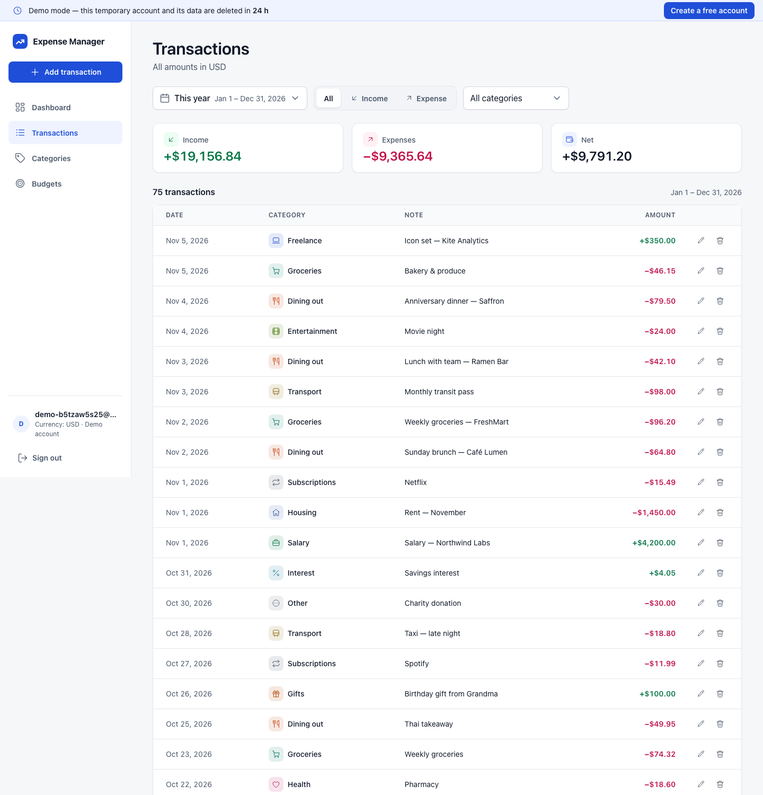
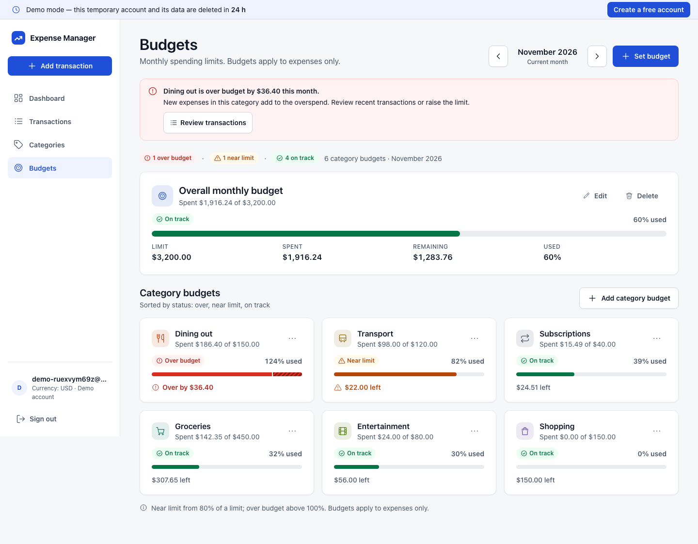
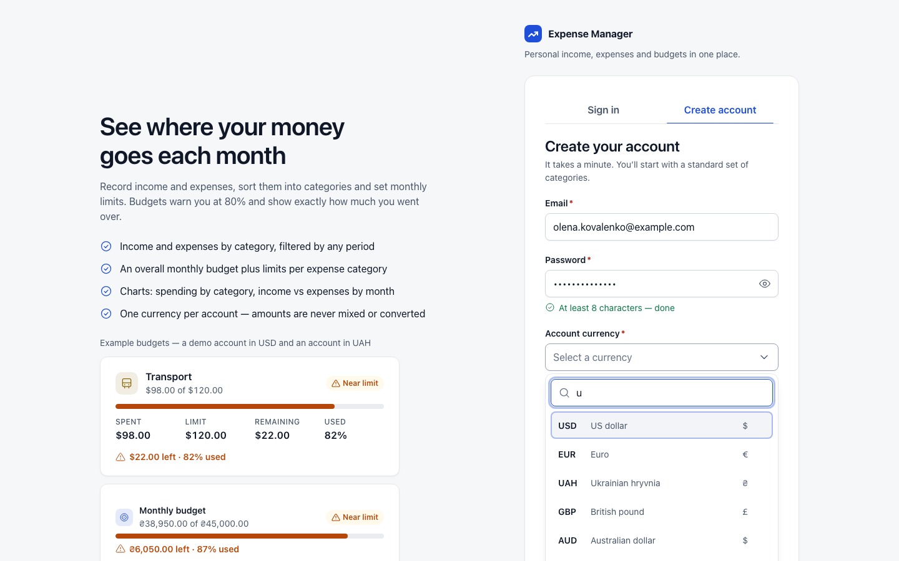
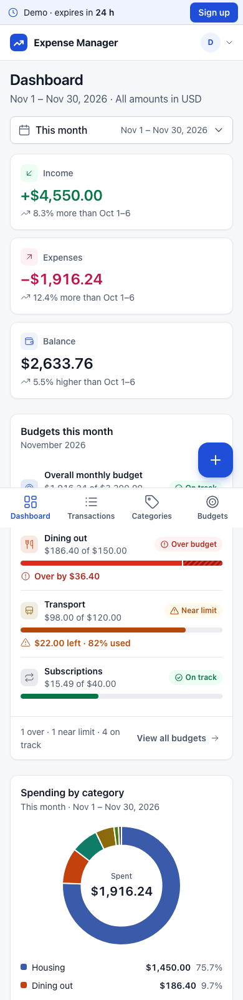

# Expense Manager

A personal income & expense tracker: record transactions, sort them into categories, set
monthly budgets that warn you before you overspend, and see where the money goes on a
dashboard with charts. Server-rendered Symfony app with HTMX/Alpine.js interactivity,
responsive from 390 px phones to 1440 px desktops.



## Features

* **Transactions** — income and expenses with category, date and an optional note; create,
  edit and delete (with confirmation) in a dialog / mobile bottom sheet; filter by period,
  type and category with totals for the filtered set; quick add right on the dashboard.
* **Categories** — separate income and expense categories with a default set for new
  accounts; create and rename (unique names), delete with mandatory reassignment of existing
  transactions; the last category of a type is protected.
* **Budgets with warnings** — an overall monthly budget plus limits per expense category:
  spent, remaining and percentage, with *on track* (< 80 %), *near limit* (80–100 %) and
  *over budget* (> 100 %, with the exact overrun) states and an over-budget banner. Limits
  carry over to the next month until you change them; past months never change.
* **Dashboard & charts** — income, expenses and balance compared with the same span of the
  previous period, a doughnut of spending by category, income vs expenses by month, current
  budgets and recent transactions (Chart.js).
* **Period filter** — this month, last month, this year or any custom date range.
* **Account currency** — one ISO 4217 currency per account, chosen at sign-up with a searchable
  picker; every amount, budget and report uses it, never mixed or converted. Money is stored
  as integer minor units, never floats.
* **Demo mode** — “Try demo” opens the app instantly with a temporary, isolated account full of
  realistic sample data. It lives 24 hours: a banner counts down, a warning appears 10 minutes
  before the end, and a background scheduler deletes the account and all its data.
* **Accounts & privacy** — email + password sign-up, form login with CSRF protection and login
  throttling; every query is scoped to the signed-in account.
* **Accessibility** — states are never conveyed by colour alone (signs, icons and text), full
  keyboard support for dialogs, menus, tabs and the currency picker.

| Transactions | Budgets |
| --- | --- |
|  |  |

| Sign up with account currency | Mobile |
| --- | --- |
|  |  |

## Stack

| Layer | Choice |
| --- | --- |
| Language / framework | PHP 8.5, Symfony 8.1, server-side rendering with Twig |
| Front end | HTMX (fragments, form submits), Alpine.js (page state), Chart.js, Tailwind CSS v4 + the design's CSS |
| Asset pipeline | Symfony AssetMapper + importmap (no Node build) and `symfonycasts/tailwind-bundle` (standalone Tailwind CLI) |
| Data | SQLite, Doctrine ORM, Doctrine Migrations |
| Auth | Symfony Security: form login (CSRF, login throttling), `auto` password hasher |
| Background jobs | Symfony Scheduler + Messenger (`scheduler` container) |
| Web server | FrankenPHP (Caddy + PHP in one process) in Docker |
| Tests | PHPUnit (unit / integration / functional), Playwright (e2e, desktop + mobile) |

Node.js is only needed on the host to run Playwright; it is not part of the app build.

## Quick start (Docker)

```bash
docker compose up -d --build --wait     # build, start app + scheduler, wait for the healthcheck
open http://127.0.0.1:8089/             # sign in / create account / "Try demo"
docker compose logs -f app scheduler
docker compose down                     # stop (data is kept)
docker compose down -v                  # stop and delete the database volume
```

* Port: `127.0.0.1:8089` (override with `APP_PORT=9000 docker compose up -d`).
* `app` applies pending Doctrine migrations (`--all-or-nothing`) before serving requests.
* `scheduler` runs `messenger:consume scheduler_default`: every minute it deletes expired demo
  accounts with all their data (`App\Schedule` → `PurgeExpiredDemos`). It shares the image and
  the `app_data` volume with `app`.
* The SQLite file lives in the named volume `app_data` (`/app/var/data/app.db`).
* `APP_SECRET` is never committed. Pass it as an environment variable, or leave it empty:
  the app generates a random secret once and stores it in the data volume.
* Healthcheck endpoint: `GET /healthz`.

## Product rules

* **Accounts**: email + password (≥ 8 characters) + account currency (ISO 4217, searchable
  picker). Every query is scoped to the signed-in account; another account's ids are "not found".
  New accounts get the default categories (12 expense, 6 income).
* **Money**: stored as integers in minor units of the account currency (`BIGINT`, e.g. cents;
  0 decimals for JPY). Parsing/formatting never uses floats; floats only feed chart canvases.
  Display: Intl en-US, narrow symbol, `+` / `−` (U+2212) signs.
* **Periods**: this month, last month, this year, custom range (from ≤ to), relative to today.
* **Budgets**: expenses only; overall monthly limit + per-category limits. States: on track
  < 80 %, near limit 80–100 %, over > 100 %. A month without its own budgets uses the latest
  earlier month's limits; changing a month copies them first, so past months never change.
* **Categories**: unique names per account and type (case-insensitive); deleting a category
  with transactions requires moving them to another category of the same type (one DB
  transaction, its budgets are removed); the last category of a type can't be deleted.
* **Demo**: "Try demo" (POST + CSRF, rate-limited: 5/hour per IP, 300/hour overall) creates a
  separate temporary USD account with sample data relative to today (budgets over / near / on
  track). It lives 24 h: banner countdown, a one-time warning 10 minutes before the end, then
  the "demo ended" screen; the account is deleted by the scheduler (or on the next request).

## Development tooling

All PHP commands run in the `tools` container (PHP 8.5 + Composer, source bind-mounted);
no local PHP is required.

```bash
docker compose build tools
docker compose run --rm tools composer install
docker compose run --rm tools php bin/console debug:router
docker compose run --rm tools php bin/console tailwind:build --watch
docker compose run --rm tools php bin/console make:migration    # after entity changes

# dev server with the source bind-mounted (http://127.0.0.1:8090)
docker compose run -d --name em-dev -p 127.0.0.1:8090:80 -e APP_ENV=dev \
  --entrypoint app-entrypoint tools frankenphp run --config /etc/frankenphp/Caddyfile

# support / testing commands
php bin/console app:demo:expire <demo-email> --in=540   # move a demo's expiry (seconds from now)
php bin/console app:demo:purge                         # delete expired demos now
```

## Tests

```bash
# PHPUnit: unit + integration + functional. Separate SQLite DB (var/data/test.db) that
# tests/bootstrap.php recreates from the migrations on every run. APP_ENV=test is required
# because the tools container defaults to dev. TEST_DB_NAME=test_x isolates parallel runs.
# On a fresh clone the bootstrap also builds the Tailwind stylesheet once (needs internet).
docker compose run --rm tools composer install
docker compose run --rm -e APP_ENV=test tools php bin/phpunit

# Playwright e2e against the running Docker app (start it first: docker compose up -d --wait)
npm install --include=dev          # --include=dev matters if NODE_ENV=production is set
npx playwright install chromium
npx playwright test                # projects: desktop (1440×900) and mobile (390×844)
```

`E2E_BASE_URL` overrides the target URL; `E2E_CONSOLE` overrides how e2e tests run console
commands (default `docker compose exec -T app php bin/console`).

## Project structure

```
assets/app.js           JS entrypoint: HTMX config, Alpine, UI primitives, charts
assets/lib/             ui.js (modals, menus, tabs, combobox, toasts, validation), charts.js,
                        components.js + pages/*.js (Alpine components)
assets/styles/          design tokens/components (design/), per-screen CSS (pages/), product additions
config/                 Symfony configuration (security, rate limiter, messenger, lock, ...)
docker/                 entrypoint.sh (secret + migrations), php.ini
migrations/             versioned Doctrine migrations
src/Account/            sign-up (RegistrationData, AccountRegistrar)
src/Budget/             budgets with carry-over, status calculation
src/Category/           category rules, default set
src/Command/            app:demo:expire, app:demo:purge
src/Controller/         thin controllers (Auth, Demo, Dashboard, Transaction, Category, Budget, /healthz)
src/Dashboard/          dashboard figures (totals, comparison, charts)
src/Demo/               demo account factory + data, expiry listener, purger, scheduler message
src/Entity/ Repository/ Doctrine entities and owner-scoped repositories
src/Finance/            periods, date formats, filters
src/Http/Htmx.php       HTMX responses (toast + refresh) with no-JS fallback
src/Money/              currencies (ICU), minor-unit parser/formatter
src/Schedule.php        Symfony Scheduler: purge expired demos every minute
src/Transaction/        transaction input validation and persistence
templates/              Twig: base + app shell, macros, screens
tests/                  Unit | Integration | Functional (PHPUnit), Support helpers, e2e (Playwright)
```

## License

Released under the [MIT License](LICENSE). © 2026 Nestor Lozynskyi.
